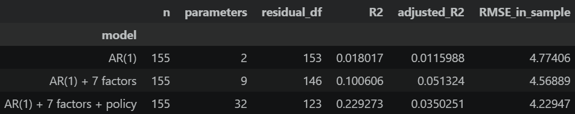
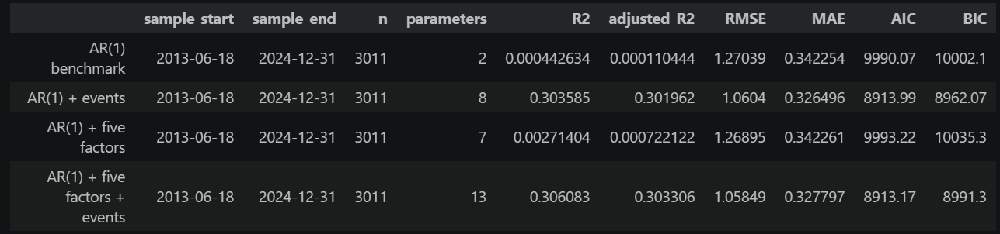

<h3 align="center">
Sierra Leone Exchange Rate Research

塞拉利昂汇率研究
</h3>

> **作者 Author:** Yi Yang (Kitazaki-Hinata)
> 
> **最后更新 Last Update:** 2026-Oct-27

<p align="center">
    语言 Language ： 简体中文 | <a href="doc/README_EN.md">English</a>
</p>

---

### 一、项目介绍

本项目研究塞拉利昂利昂兑美元汇率（USDSLE）与货币、财政和外汇供求因素之间的关系。 已完成两轮数据整理、因子检查和 AR(1) 回归，以及假设检验与残差诊断。分析代码、图表和结果保存在七个 Jupyter 笔记本中（在```notebook```文件夹当中）。

---

### 二、测试模型与测试方法

#### 2.1 ```data```文件夹的数据目录
一共包含以下类别的数据：

| 目录/名称 | 说明                                                                                                |
|---|---------------------------------------------------------------------------------------------------|
| `source` | 数据源下载的原始数据                                                                                        |
| `cleaned` | 进行了初步数据清洗、时间戳整理的数据                                                                                |
| `final_daily` | 以日为时间周期的数据；因为后续相关性研究使用月度周期，所以这里仅作为数据清洗后的备份                                                        |
| `final_monthly` | **重要：** 第一次回归用到的、完整的、数据清洗过的、时间戳统一且进行过时间戳截断的数据                                                     |
| `2_regression_monthly` |  **重要：** 第二次回归用到的最终数据                                                                                      |
| `IMF_predict_data` | IMF 提供的塞拉利昂宏观经济预测数据的源数据                                                                           |
| `POS_actual_predict_origin` | 包含所有实际数据和 IMF 预测数据，并进行了初步数据整理和发布日期错位/滞后处理                                                            |
| `3_POS_prediction` |  **重要：** 用于 POS 模型验证阶段的最终数据；其中 GDP、trade balance 和政府债务/GDP 三个数据集合了 IMF 预测值和实际值，对应数据第三列标出，`0` 为实际值，`1` 为预测值 |

---

#### 2.2 初始模型（第一阶段回归）

月度数据位于 `data/final_monthly/`，覆盖 2012 年 1 月至 2026 年 6 月，共 174 个月末日期。当前诊断使用 2012 年 1 月至 2024 年 12 月的训练数据。

设 E(t) 为每美元兑换的利昂数量，汇率变化率为：

```text
Y(t) = 100 × [ln E(t) − ln E(t−1)]
```

Y(t) > 0 表示利昂贬值，Y(t) < 0 表示利昂升值。

初始模型的候选变量框架：

```text
Y(t) = α + βY × Y(t−1) + βM × M(t) + βR × R(t) + βO × O(t) + βF × F(t)
         + βD × D(t) + βC × C(t) + βI × I(t)
         + γ1 × P1(t) + … + γK × PK(t) + ε(t)
```

α 为截距，β 和 γ 为系数，ε(t) 为误差项。该框架下的数据整理、因子诊断和初始回归已完成，回归见 [4_auto_regression_model.ipynb](notebook/4_auto_regression_model.ipynb)。

| 符号 | 变量定义 |
|---|---|
| Y(t−1) | 上一期 USDSLE 对数变化率 |
| M(t) | 基础货币对数变化率 |
| R(t) | 外汇储备对数变化率 |
| O(t) | 矿物燃料及润滑油进口额对数变化率 |
| F(t) | 食品进口额对数变化率 |
| D(t) | 政府债务/GDP 年度百分点变化，同年各月重复 |
| C(t) | 经常账户/GDP 年度百分点变化，同年各月重复 |
| I(t) | 铁矿石出口额对数变化率 |
| P1(t) 至 PK(t) | 政策事件 dummy：当月发生为 1，其余为 0 |

对数变化率统一按 `100 × [ln X(t) − ln X(t−1)]` 计算。政策记录见[政策事件表](data/source/Sierra_Leone_Policy_Events_2000_2026.csv)，数据来源与变量信息见[元数据表](data/metadata.xlsx)。

---

#### 2.3 检验因子流程

| 阶段 | 笔记本 | 已完成内容 |
|---|---|---|
| 描述性统计 | [1_descriptive.ipynb](notebook/1_descriptive.ipynb) | 样本与缺失检查、分布统计、滚动均值与标准差、趋势和季节性筛查 |
| 平稳性检验 | [2_adf.ipynb](notebook/2_adf.ipynb) | ADF、KPSS 及滞后设定敏感性检查，显著性水平为 0.05；年度变量按年检验 |
| 共线性检查 | [3_colinearity_check.ipynb](notebook/3_colinearity_check.ipynb) | 七个同期因子的 Pearson 相关矩阵、热力图、VIF 和矩阵秩；样本含 156 个月，使用原版铁矿石序列，排除 USDSLE 和政策 dummy |
| 初始回归 | [4_auto_regression_model.ipynb](notebook/4_auto_regression_model.ipynb) | 汇率滞后一期、七个宏观因子及政策事件项的 OLS 回归，HAC 假设检验和残差诊断 |

---

#### 2.4 初始回归结果
经过数据清洗和截断，季节性检查，单位根检查和共线性检查之后，模型的β值的p-value结果如下：
- 基础货币 Base money p ： 0.47501
- 燃料进口 Fuel Imports p : 0.913434
- 食品进口 Food Imports p : 0.626493
- 铁矿石出口 Iron ore exports p：0.851677
- 经常账户 Current Account p ：0.200116
<p align="center">
  
</p>

  具体数据参见[4_auto_regression_model.ipynb](notebook/4_auto_regression_model.ipynb) 。由于整体解释力度不足，因此第二次回归选择替换宏观因子和事件政策dummy因子并进行重新回归。

---

#### 2.5 二阶段模型（第二次回归）


第二轮输入位于 [data/2_regression_monthly/](data/2_regression_monthly/)，各文件均保留 2012 年 1 月至 2026 年 6 月的 174 个月末日期。数值序列读取日期和数值列，政府债务文件中的 `period_classification` 不进入回归。

| 数据 | 回归输入文件 | 来源 |
|---|---|---|
| USDSLE | [USDSLE_monthly.csv](data/2_regression_monthly/USDSLE_monthly.csv) | 沿用 [初始月度汇率](data/final_monthly/USDSLE_monthly.csv)，原始新旧利昂汇率文件为 `USDSLE1DICE.csv`、`USDSLL1DICE.csv` |
| CPI | [headline_cpi_log_change_monthly.csv](data/2_regression_monthly/headline_cpi_log_change_monthly.csv) | [WORLDInfla.xlsx](data/source/WORLDInfla.xlsx) 的 `hcpi_m`，World Bank Inflation Database，指数底层来源为 IFS |
| GDP 增长率变化 | [gdp_annual_pct_change_monthly.csv](data/2_regression_monthly/gdp_annual_pct_change_monthly.csv) | [WORLDGDP.csv](data/source/WORLDGDP.csv)，World Bank WDI，`NY.GDP.MKTP.KD.ZG` |
| 贸易差额变化 | [trade_balance_annual_pct_change_monthly.csv](data/2_regression_monthly/trade_balance_annual_pct_change_monthly.csv) | [SLEBalanceofTrade.xls](data/source/SLEBalanceofTrade.xls)，World Bank WDI，货物净贸易余额（当年美元），`BN.GSR.MRCH.CD` |
| 外汇储备 | [fx_reserves_log_change_monthly.csv](data/2_regression_monthly/fx_reserves_log_change_monthly.csv) | [储备与基础货币原始工作簿](data/source/A-sierra_leone_reserves_base_money_monthly.xlsx)，IMF IFS |
| 政府债务/GDP | [general_government_gross_debt_annual_change_pp_monthly.csv](data/2_regression_monthly/general_government_gross_debt_annual_change_pp_monthly.csv) | IMF WEO，`GGXWDG_NGDP`；中间数据位于 `data/cleaned/5. IMF_general_government_gross_debt_percent_gdp.csv` |
| 事件 dummy | [Sierra_Leone_Policy_Event_Dummies_monthly.csv](data/2_regression_monthly/Sierra_Leone_Policy_Event_Dummies_monthly.csv) | 六个事件列，整理说明见 [5_second_data_check.ipynb](notebook/5_second_data_check.ipynb) |

CPI 中间文件的日期标签比统计月份晚一个月，年度 GDP 和贸易差额的 `YYYY0101` 标签对应 `YYYY−1` 年；最终输入已按统计期对齐。GDP 和贸易差额使用 2011 年作为计算 2012 年变化的基期。三项年度因子将当年变化值重复填入各月，不除以 12。

缺失值保留为空：CPI 首月为空，有效变化值截至 2025 年 3 月；GDP 截至 2025 年 12 月；贸易差额截至 2024 年 12 月，原先被填充的 2025 年值已恢复为空；外汇储备截至 2025 年 4 月。政府债务的 2026 年数据标为预测值。2025 年及以后的数据不参与当前训练期的拟合与诊断。

---

#### 2.6 最终模型
最终模型见 [6_second_regression.ipynb](notebook/6_second_regression.ipynb)。模型在完整月历上生成汇率滞后一期，再取共同非缺失样本，实际回归覆盖 2012 年 2 月至 2024 年 12 月，共 155 个月。

```text
Y(t) = α + φ × Y(t−1) + βπ × Π(t) + βG × G(t) + βB × B(t)
         + βR × R(t) + βD × D(t) + γ1 × P1(t) + … + γ5 × P5(t) + ε(t)
```

Y(t) 仍为 `100 × [ln E(t) − ln E(t−1)]`，正值表示利昂贬值。模型包含截距、一个 AR(1) 项、五个同期宏观因子和五个可识别事件项，共 12 个参数。

<br>

> **模型回归结果：**
- R² 为 0.532932，调整后 R² 为 0.497004，样本内 RMSE 为 3.2925。
- CPI 的 Holm 校正 p 值为 0.003003，其余四个宏观因子的校正 p 值均大于 0.05；五因子联合 Wald 检验 p 值为 0.000178。
- BG 三项校正 p 值均大于 0.05；非事件月份 BP 检验 p 值为 0.383898，未拒绝各自原假设。


<br>

> **宏观因子统计：**

下表系数取自 notebook 的当前输出。设 y 为统计年份，g(y) 为原始 GDP 年度增长率（%），TB(y) 为货物贸易差额，Q(y) 为政府债务/GDP 比例（%）。

| 符号 | 变量定义 | 系数（约） |
|---|---|---:|
| α | 截距 | −0.0263524 |
| Y(t−1) | 上一期汇率对数变化率 | −0.162354 |
| Π(t) | CPI 月度对数变化：`100 × [ln CPI(t) − ln CPI(t−1)]` | 1.04130 |
| G(t) | GDP 增长率自身的年度变化：`100 × [g(y) − g(y−1)] / abs(g(y−1))` | −0.00210419 |
| B(t) | 贸易差额年度变化：`100 × [TB(y) − TB(y−1)] / abs(TB(y−1))` | 0.00115410 |
| R(t) | 外汇储备月度对数变化：`100 × [ln Reserves(t) − ln Reserves(t−1)]` | −0.107443 |
| D(t) | 政府债务/GDP 年度百分点变化：`Q(y) − Q(y−1)` | 0.0827914 |

CPI 和外汇储备中的 `1.00` 表示 1%的对数变化；GDP 和贸易差额中的 `1.00` 表示 1%的基期绝对值变化率；政府债务中的 `1.00` 表示增加 1 个百分点。GDP 因子描述增长率自身的相对变化。样本内贸易差额为负，因此 B(t) 为正表示贸易余额改善、逆差收窄。

年度变化按统计年份填入各月，训练期各有 13 个年度观测。系数描述控制其余解释变量后的条件关联，不能直接解释为因果效应。

<br>

> **事件dummy统计：**

原始事件表包含六列。2021 年 8 月的两个事件列完全相同，合并后形成五个事件项；每项在对应月份为 1，其余月份为 0。

| 模型项 | 月份 | 对应事件 | 系数（约） |
|---|---|---|---:|
| P1(t) / `P_2015_11` | 2015-11 | IMF ECF 审查与拨款 | −6.23018 |
| P2(t) / `P_2016_06` | 2016-06 | 英国脱欧公投 | 32.4303 |
| P3(t) / `P_2021_08` | 2021-08 | 货币改值公告与 SDR 分配 | 3.30607 |
| P4(t) / `P_2023_06` | 2023-06 | IMF ECF 第六、七次审查 | −20.3907 |
| P5(t) / `P_2023_11` | 2023-11 | IMF ECF 第八次审查 | −1.92627 |

---

### 三、Pseudo Out of Sample 模拟预测
#### 3.1 POS模拟规则
取2025年1月1日到2026年6月30日的数据进行POS模拟回归，用于探究模型的预测属性。
宏观数据方面，如果官方披露了对应的数据发布时间，则数据放在对应的数据发布时间。如果没有披露，则放到下个周期的月中或者年中（例如，如果对应6月的经济数据，则归类到7月15日；如果是2024年的经济数据，则归类到2025年6月18日）。

此外，回归将采用“滞后回归”和“预测值+实际值”两种处理方式。滞后回归是指数据按其实际发布日期进入模型，例如 2024 年数据只有在正式发布后才会更新，发布前只能使用当时可得的信息；预测值+实际值是指当同一指标同时存在 IMF 预测值和实际值时，构造“当日采用值”：实际值尚未发布时使用当时可得的最新预测值，实际值发布后改用实际值，并保留该值来源为预测值或实际值的标记。


---

#### 3.2 预测的局限性
1. 由于IMF披露的预测数据只给了横截面的预测数据（即只有截止当前，历史的预测数据和未来的预测数据），并没有给出**对应年份历史数据被修改时的日期**，因此只能假设IMF每年预测的数据都是维持不变的，会导致后续的预测可信度有所下降。
2. CPI、外汇储备的实际数据只更新到了2025年4月；Trade balance数据仅更新到2024年；GDP、政府债务/GDP数据仅更新到2025年，缺失的数据只能使用预测值进行预测和回归。

---

#### 3.3 POS的预测结果
<p align="center">
  
</p>
通过使用滞后的实际数据与IMF提供的预测数据进行再次回归，以及进行POS模拟预测后续汇率变化后发现，模型的解释能力出现下降，而滞后的5个宏观因子对汇率变化的解释力非常小。

笔者猜测，造成宏观因子预测与解释能力大幅下降的原因是，CPI、GDP等宏观数据是低频且滞后公布的（比如10月才公布9月的CPI）。而外汇市场是极其高效的，市场在宏观数据公布前早就通过预期完成了定价。因此，将滞后发布的宏观数据回归到已经包含了这些信息的外汇波动当中时，对预测未来一天（One-step）的汇率变动几乎没有增量信息。不过，对于SLE货币这种国际汇市流动性较弱的市场，是否能有效反应宏观因子的预期仍然存疑。

---


### 四、未来一年外汇预测与可替代性

#### 4.1 预测方式
在```9_stochastic_fx_backtest```当中，通过区分三种不同条件对汇率走势进行蒙特卡洛模拟并计算均值和CI范围。其中，模型的因子参数使用 ```6_second_regression```当中的参数。三种不同宏观环境条件包括：

设置三种指定的压力假设：5%、20%、50% 分别对应低、高、极高年化通胀；“正常”为中间情景名称。GDP 共同参考增速为 4%，用于计算增长率变化。

| 未来一年假设 | 好于预期 | 正常高通胀 | 差情况 |
|---|---:|---:|---:|
| CPI 年化增幅 | 5% | 20% | 50% |
| 实际 GDP 年增速，参考值 4% | 6% | 4% | 1% |
| 贸易赤字幅度变化 | 缩小 20% | 不变 | 扩大 30% |
| 外汇储备增幅 | 20% | 0% | -25% |
| 政府债务/GDP 年度变化 | -3 个百分点 | 0 | +8 个百分点 |

将预测值转为月度数据的方式：
- CPI 和储备：`100 * log1p(年度增幅 / 100) / 12`，得到月度对数变化。
- GDP：`100 * (情景增速 - 参考增速) / abs(参考增速)`。
- 贸易：`100 * (情景差额 - 参考差额) / abs(参考差额)`；以 -100 赤字指数为共同基点，缩小赤字产生正输入。保留原模型贸易系数为正的估计方向。
- 债务：年度债务比率变化的百分点数直接填入各月，与原回归一致。

---

#### 4.2 预测结果
预测结果在notebook 9当中： [9_stochastic_fx_backtest.ipynb](notebook/9_stochastic_fx_backtest.ipynb)。


---

#### 4.3 模型的可迁移性分析

<u>4.3.1 适用的类型</u>

对于出口收入集中于少数农产品或矿产品、同时依赖进口燃油、食品和资本品的发展中经济体，贸易收支变化可以作为分析汇率压力的起点。出口收入减少或进口支出增加，会在其他条件相同时增加本币贬值压力；外部融资、侨汇流入和央行外汇干预则可能缓解这一压力。

按照 IMF BPM6 的金融账户符号口径，国际收支恒等式可以写为：


    CA+KA-FA+EO=0


其中，CA 为经常账户余额，KA为资本账户余额，FA为外汇储备，EO为净误差（即为ε）。对于emerging market来说，通常本币导致汇率变化的因素主要来自贸易，也就是CA变化。

通胀与汇率之间的关系可以通过：1. 购买力；2. 进口成本；3.市场预期，以及其他因素进行研究。本币贬值会提高以外币计价的进口商品成本，并可能进一步传导至国内物价；传导程度随进口结构、定价方式和通胀环境变化。

相关研究发现，高通胀时期的汇率向物价传导通常更强，这说明不同国家、不同阶段的 CPI 与汇率关系可能存在明显差异。 本项目在塞拉利昂样本中发现的 CPI 与汇率相关关系，可以用于构建该国的宏观情景，但其他国家对应的系数和预测表现需要由当地数据确定。

<br>
<u>4.3.2 模型设定</u>

本项目的可迁移性分别体现在基础随机模型（对照组模型）和宏观情景模型（实际模型）两个部分。

基础随机模型使用历史汇率的对数收益率估计均值和波动率，并通过蒙特卡洛模拟生成未来路径。这一过程仅依赖目标货币的历史汇率，应用范围可以覆盖不同产业结构的经济体。设 $S_{t,c}$ 为国家 $c$ 每美元对应的本币数量，则：

$$
r^{(j)}_{k}
=\ln\left(\frac{S^{(j)}_{k}}{S^{(j)}_{k-1}}\right)
=m^{(j)}+\hat{\sigma} z_k,
\qquad
z_k\sim N(0,1),
$$

$$
m^{(j)}=
\begin{cases}
\hat{\mu}, & j=\mathrm{hist},\\
0, & j=\mathrm{zero}.
\end{cases}
$$

应用于另一种货币时，使用该货币的数据重新估计 $\hat{\mu}_c$ 和 $\hat{\sigma}_c$，并以预测起点的实际汇率作为初值。路径生成、分位数计算和终点分布展示可以沿用相同程序。常数均值、常数波动率和独立正态冲击仍是这一基础版本的模型假设，其合理性通过目标货币的历史表现和样本外检验评估。

**相对应的，宏观情景模型的迁移涉及更多国别信息**。现有模型使用 CPI、GDP 增长率变化、贸易差额变化、外汇储备和政府债务/GDP 等变量，将给定的宏观假设转换为汇率条件路径。应用于其他国家时，这些变量可以作为初始候选集合，并根据其外汇收入来源和政策制度调整。例如，商品出口型经济体可以考察主要出口商品价格和出口收入，侨汇依赖程度较高的经济体可以考察侨汇流量，跨境证券投资较活跃的经济体可以考察资本流动和利差。变量是否保留，由经济含义、数据可得性和样本外表现共同决定。

不同货币所需调整的内容如下：

| 模型部分 | 重新校准或调整的内容 |
|---|---|
| 汇率输入与初始值 | 使用目标货币的历史报价和预测起点汇率，统一为“每美元对应的本币数量” |
| 基础随机参数 | 根据目标货币的校准样本重新估计对数收益率均值与标准差 |
| 时间与交易日历 | 设置当地交易日、节假日、报价时区和停更日规则，使参数估计与模拟使用一致的时间口径 |
| 宏观变量 | 根据目标经济体选择因子，统一变量定义、计量单位和原始频率 |
| 回归参数与事件项 | 重新估计截距、AR 系数、宏观因子系数及当地历史事件的控制项 |
| 随机误差 | 根据重新估计后的残差校准波动率，检查偏度、厚尾和时间相关性 |
| 未来情景 | 根据当地经济环境设定通胀、增长、贸易、储备和债务变化等假设 |

<br>
<u>4.3.3 测试方法&其他</u>

迁移后的模型通过Pseudo Out of Sample （POS），也就是独立的 12 个月预测窗口进行评价。均值或中位数预测使用 RMSE、MAE 与简单基准比较；随机路径使用预测区间的覆盖情况和宽度评价。在完成这些检验后，才能判断同一套建模流程在目标货币上是否具有实际价值。本项目目前的实证结果覆盖塞拉利昂，其他货币的预测表现仍有待重新校准和验证。

模型的适用边界主要与汇率制度和参数稳定性有关。对于具有一定汇率浮动空间的货币，历史收益率可以为日常波动提供校准依据。对于长期盯住美元的货币，历史样本可能表现出较低波动，仅使用这一波动率难以描述未来调整汇率平价的风险，相关分析需要另外设置平价调整或脱钩情景。对于盯住其他货币的经济体，兑美元路径还受到锚定货币兑美元变化的影响。经历重大政策转变的国家，则需要根据新制度下的数据重新选择校准窗口。


---

### 五、Python 使用方法与项目架构

#### 5.1 目录结构

主要文件结构：

```text
SLE_research/
├── README.md
├── LICENSE
├── pyproject.toml
├── uv.lock
├── .python-version
├── doc/
│   ├── README_EN.md
│   └── figure/
│       └── fig1_first_regression.png # 初始回归结果图
├── data/
│   ├── metadata.xlsx
│   ├── source/              # 原始数据
│   ├── cleaned/             # 整理后的中间数据
│   ├── final_daily/         # 日度汇率与政策事件数据
│   ├── final_monthly/       # 初始模型的月度数据
│   ├── 2_regression_monthly/ # 第二轮回归的月度数据
│   ├── IMF_predict_data/    # IMF 宏观经济预测源数据
│   ├── POS_actual_predict_origin/ # 按发布日期对齐的实际与预测数据
│   └── 3_POS_prediction/    # POS 模型验证的最终日度数据
│       ├── USDSLE_daily.csv
│       ├── headline_cpi_log_change_daily.csv
│       ├── gdp_annual_pct_change_daily.csv
│       ├── trade_balance_annual_pct_change_daily.csv
│       ├── fx_reserves_log_change_daily.csv
│       ├── general_government_gross_debt_annual_change_pp_daily.csv
│       └── Sierra_Leone_Policy_Event_Dummies_daily.csv
├── scripts/
│   ├── prepare_trade_monthly.py
│   ├── prepare_money_reserves_monthly.py
│   ├── prepare_annual_changes_monthly.py
│   ├── prepare_iron_ore_no_long_fill.py
│   ├── collect_cpi_release_evidence.py
│   └── prepare_pos_daily_factors.py
└── notebook/
    ├── 1_descriptive.ipynb
    ├── 2_adf.ipynb
    ├── 3_colinearity_check.ipynb
    ├── 4_auto_regression_model.ipynb
    ├── 5_second_data_check.ipynb
    ├── 6_second_regression.ipynb
    ├── 7_POS_model_retest.ipynb
    └── 8_POS_mock_prediction # POS 模拟预测预留文件，暂无扩展名
```

#### 5.2 运行方法

对于部分用于处理数据的python脚本，项目使用 Python 3.13 和 uv。在项目根目录安装依赖然后单独运行每个脚本（注：本项目没有main.py）：

```powershell
# powershell
uv sync
```

主要的模型回归与模型预测的过程均存放在```notebook/```当中。在支持 Jupyter 的编辑器中选择项目 `.venv` 的 Python 内核，按编号运行 `notebook/` 下的七个笔记本。1–4 对应初始模型，5–6 对应第二轮数据检查和回归，7 对应 POS 初始模型重估及基准比较。笔记本支持从项目根目录或 `notebook/` 目录读取数据，表格和图形保存在笔记本内。


