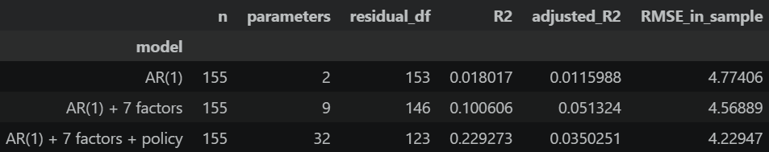
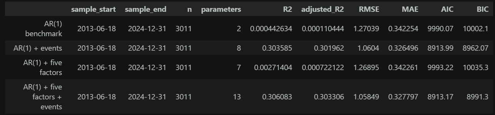

<h3 align="center">
Sierra Leone Exchange Rate Research
</h3>

> **Author:** Yi Yang (Kitazaki-Hinata)
>
> **Last Update:** 2026-Oct-27

<p align="center">
    Language: <a href="../README.md">简体中文</a> | English
</p>

---

### 1. Project Introduction

This project studies the relationship between the Sierra Leone leone exchange rate against the US dollar (USDSLE) and monetary, fiscal, and foreign exchange supply and demand factors. Two rounds of data preparation, factor checks, and AR(1) regression have been completed, along with hypothesis tests and residual diagnostics. The analysis code, charts, and results are saved in seven Jupyter notebooks in the `notebook` folder.

---

### 2. Models and Testing Methods

#### 2.1 Data Directories

The `data` folder contains the following categories:

| Directory/name | Description |
|---|---|
| `source` | Raw data downloaded from the source providers |
| `cleaned` | Data after initial cleaning and timestamp preparation |
| `final_daily` | Daily data retained as a backup after cleaning, since the subsequent correlation analysis uses monthly periods |
| `final_monthly` | **Important:** Complete, cleaned data for the first regression, with standardized timestamps and the selected date range applied |
| `2_regression_monthly` | **Important:** Final data for the second regression |
| `IMF_predict_data` | Source data for IMF forecasts of Sierra Leone's macroeconomic indicators |
| `POS_actual_predict_origin` | Actual observations and IMF forecasts after initial preparation and alignment to publication dates or assumed release lags |
| `3_POS_prediction` | **Important:** Final data for POS model validation. GDP, the trade balance, and government debt/GDP combine IMF forecasts with actual observations; the third column identifies actual values as `0` and forecasts as `1` |

---

#### 2.2 Initial Model (First-Stage Regression)

Monthly data are stored in `data/final_monthly/`, covering January 2012 through June 2026 with 174 month-end dates. The current diagnostics use training data from January 2012 through December 2024.

Let E(t) denote the number of leones per US dollar. The exchange rate change is:

```text
Y(t) = 100 × [ln E(t) − ln E(t−1)]
```

Y(t) > 0 indicates leone depreciation, while Y(t) < 0 indicates leone appreciation.

The candidate variable framework for the initial model is:

```text
Y(t) = α + βY × Y(t−1) + βM × M(t) + βR × R(t) + βO × O(t) + βF × F(t)
         + βD × D(t) + βC × C(t) + βI × I(t)
         + γ1 × P1(t) + … + γK × PK(t) + ε(t)
```

α is the intercept, β and γ are coefficients, and ε(t) is the error term. Data preparation, factor diagnostics, and the initial regression under this framework have been completed. See [4_auto_regression_model.ipynb](../notebook/4_auto_regression_model.ipynb) for the regression.

| Symbol | Variable definition |
|---|---|
| Y(t−1) | Previous-period USDSLE log change |
| M(t) | Base money log change |
| R(t) | Foreign exchange reserves log change |
| O(t) | Log change in the value of mineral fuel and lubricant imports |
| F(t) | Log change in the value of food imports |
| D(t) | Annual percentage-point change in government debt/GDP, repeated across months within the year |
| C(t) | Annual percentage-point change in current account/GDP, repeated across months within the year |
| I(t) | Log change in the value of iron ore exports |
| P1(t) to PK(t) | Policy event dummies: 1 in the month of the event and 0 otherwise |

All log changes are calculated as `100 × [ln X(t) − ln X(t−1)]`. Policy records are available in the [policy event table](../data/source/Sierra_Leone_Policy_Events_2000_2026.csv), and data sources and variable information are available in the [metadata workbook](../data/metadata.xlsx).

---

#### 2.3 Factor Testing Workflow

| Stage | Notebook | Completed work |
|---|---|---|
| Descriptive statistics | [1_descriptive.ipynb](../notebook/1_descriptive.ipynb) | Sample and missing-value checks, distribution statistics, rolling means and standard deviations, and trend and seasonality screening |
| Stationarity tests | [2_adf.ipynb](../notebook/2_adf.ipynb) | ADF, KPSS, and lag specification sensitivity checks at a significance level of 0.05; annual variables tested at annual frequency |
| Collinearity diagnostics | [3_colinearity_check.ipynb](../notebook/3_colinearity_check.ipynb) | Pearson correlation matrix, heatmap, VIF, and matrix rank for seven contemporaneous factors; 156 months using the original iron ore series, excluding USDSLE and policy dummies |
| Initial regression | [4_auto_regression_model.ipynb](../notebook/4_auto_regression_model.ipynb) | OLS regression with the lagged exchange rate change, seven macro factors, and policy event terms; HAC hypothesis tests and residual diagnostics |

---

#### 2.4 Initial Regression Results

After data cleaning and truncation, seasonality checks, unit root tests, and collinearity checks, the p-values for the model's β coefficients are:

- Base money p: 0.47501
- Fuel imports p: 0.913434
- Food imports p: 0.626493
- Iron ore exports p: 0.851677
- Current account p: 0.200116

<p align="center">
  
</p>

See [4_auto_regression_model.ipynb](../notebook/4_auto_regression_model.ipynb) for the detailed results. Given the limited overall explanatory power, the macro factors and policy event dummies were replaced for a second regression.

---

#### 2.5 Second Regression

The second-round inputs are stored in [data/2_regression_monthly/](../data/2_regression_monthly/). Each file retains 174 month-end dates from January 2012 through June 2026. Numerical series use the date and value columns; the government debt file's `period_classification` column is excluded from the regression.

| Data | Regression input file | Source |
|---|---|---|
| USDSLE | [USDSLE_monthly.csv](../data/2_regression_monthly/USDSLE_monthly.csv) | Reuses the [initial monthly exchange rate series](../data/final_monthly/USDSLE_monthly.csv), based on the new and old leone files `USDSLE1DICE.csv` and `USDSLL1DICE.csv` |
| CPI | [headline_cpi_log_change_monthly.csv](../data/2_regression_monthly/headline_cpi_log_change_monthly.csv) | The `hcpi_m` sheet in [WORLDInfla.xlsx](../data/source/WORLDInfla.xlsx), World Bank Inflation Database, with IFS as the underlying index source |
| Change in GDP growth | [gdp_annual_pct_change_monthly.csv](../data/2_regression_monthly/gdp_annual_pct_change_monthly.csv) | [WORLDGDP.csv](../data/source/WORLDGDP.csv), World Bank WDI, `NY.GDP.MKTP.KD.ZG` |
| Change in trade balance | [trade_balance_annual_pct_change_monthly.csv](../data/2_regression_monthly/trade_balance_annual_pct_change_monthly.csv) | [SLEBalanceofTrade.xls](../data/source/SLEBalanceofTrade.xls), World Bank WDI, net trade in goods in current US dollars, `BN.GSR.MRCH.CD` |
| Foreign exchange reserves | [fx_reserves_log_change_monthly.csv](../data/2_regression_monthly/fx_reserves_log_change_monthly.csv) | The [reserves and base money source workbook](../data/source/A-sierra_leone_reserves_base_money_monthly.xlsx), IMF IFS |
| Government debt/GDP | [general_government_gross_debt_annual_change_pp_monthly.csv](../data/2_regression_monthly/general_government_gross_debt_annual_change_pp_monthly.csv) | IMF WEO, `GGXWDG_NGDP`; intermediate data in `data/cleaned/5. IMF_general_government_gross_debt_percent_gdp.csv` |
| Event dummies | [Sierra_Leone_Policy_Event_Dummies_monthly.csv](../data/2_regression_monthly/Sierra_Leone_Policy_Event_Dummies_monthly.csv) | Six event columns, documented in [5_second_data_check.ipynb](../notebook/5_second_data_check.ipynb) |

The intermediate CPI date labels are one month later than the statistical month. Annual GDP and trade balance labels of `YYYY0101` represent year `YYYY−1`; the final inputs are aligned with the statistical periods. GDP and trade balance changes for 2012 use 2011 as their base year. All three annual factors repeat each year's change across its months without dividing by 12.

Missing values remain blank: CPI is missing in the first month and has valid changes through March 2025; GDP extends through December 2025; the trade balance extends through December 2024, with the previously filled 2025 value restored to missing; foreign exchange reserves extend through April 2025. Government debt data for 2026 are marked as projections. Data from 2025 onward are excluded from the current training-period estimation and diagnostics.

---

#### 2.6 Final Model

The final model is implemented in [6_second_regression.ipynb](../notebook/6_second_regression.ipynb). The exchange rate lag is constructed on the full monthly calendar before selecting observations with no missing values across the model variables. The estimation sample covers February 2012 through December 2024, comprising 155 months.

```text
Y(t) = α + φ × Y(t−1) + βπ × Π(t) + βG × G(t) + βB × B(t)
         + βR × R(t) + βD × D(t) + γ1 × P1(t) + … + γ5 × P5(t) + ε(t)
```

Y(t) remains `100 × [ln E(t) − ln E(t−1)]`, with positive values indicating leone depreciation. The model has an intercept, one AR(1) term, five contemporaneous macro factors, and five identifiable event terms, giving 12 parameters.

<br>

> **Regression results:**

- R² is 0.532932, adjusted R² is 0.497004, and in-sample RMSE is 3.2925.
- CPI has a Holm-adjusted p-value of 0.003003; the other four macro factors have adjusted p-values above 0.05. The joint Wald p-value for the five factors is 0.000178.
- All three adjusted BG p-values exceed 0.05; the BP test p-value for non-event months is 0.383898. The respective null hypotheses are not rejected.

<br>

> **Macro factor statistics:**

The coefficients below are taken from the notebook's current output. Let y denote the statistical year, g(y) the original annual GDP growth rate (%), TB(y) the goods trade balance, and Q(y) the government debt/GDP ratio (%).

| Symbol | Variable definition | Approximate coefficient |
|---|---|---:|
| α | Intercept | −0.0263524 |
| Y(t−1) | Previous-period exchange rate log change | −0.162354 |
| Π(t) | Monthly CPI log change: `100 × [ln CPI(t) − ln CPI(t−1)]` | 1.04130 |
| G(t) | Annual change in the GDP growth rate itself: `100 × [g(y) − g(y−1)] / abs(g(y−1))` | −0.00210419 |
| B(t) | Annual trade balance change: `100 × [TB(y) − TB(y−1)] / abs(TB(y−1))` | 0.00115410 |
| R(t) | Monthly foreign exchange reserves log change: `100 × [ln Reserves(t) − ln Reserves(t−1)]` | −0.107443 |
| D(t) | Annual percentage-point change in government debt/GDP: `Q(y) − Q(y−1)` | 0.0827914 |

For CPI and foreign exchange reserves, `1.00` represents a 1% log change. For GDP and the trade balance, `1.00` represents a change equal to 1% of the absolute base-period value. For government debt, `1.00` represents an increase of one percentage point. The GDP factor measures relative changes in the growth rate itself. The trade balance is negative in the sample, so a positive B(t) indicates an improvement in the balance and a narrowing deficit.

Annual changes are repeated across the months of their statistical year, with 13 annual observations per series in the training period. Coefficients describe conditional associations after controlling for the other explanatory variables and cannot be directly interpreted as causal effects.

<br>

> **Event dummy statistics:**

The original event table has six columns. The two August 2021 event columns are identical and are merged to form five event terms. Each term is 1 in its event month and 0 otherwise.

| Model term | Month | Event | Approximate coefficient |
|---|---|---|---:|
| P1(t) / `P_2015_11` | 2015-11 | IMF ECF review and disbursement | −6.23018 |
| P2(t) / `P_2016_06` | 2016-06 | UK referendum on EU membership | 32.4303 |
| P3(t) / `P_2021_08` | 2021-08 | Redenomination announcement and SDR allocation | 3.30607 |
| P4(t) / `P_2023_06` | 2023-06 | Sixth and seventh IMF ECF reviews | −20.3907 |
| P5(t) / `P_2023_11` | 2023-11 | Eighth IMF ECF review | −1.92627 |

---

### 3. Pseudo Out of Sample Forecasting

#### 3.1 POS Simulation Rules

Data from January 1, 2025 through June 30, 2026 are used for POS regression simulations to assess the model's predictive properties.

When an official publication date is available for a macroeconomic observation, the data are assigned to that date. Otherwise, the observation is assigned to the middle of the following month or year. For example, June data are assigned to July 15, and annual data for 2024 are assigned to June 18, 2025.

The regression will also use two approaches: accounting for publication delays and combining forecast and actual values. Accounting for publication delays means that data enter the model on their publication date. For example, 2024 data are updated only after their official release; before then, the model can use only information available at that time. Combining forecast and actual values means constructing a daily adopted value for an indicator with both IMF forecasts and actual observations. Before the actual value is released, the latest forecast available at the time is used. After release, the actual value is used, and a flag records whether the adopted value is a forecast or an actual observation.

---

#### 3.2 Forecast Limitations

1. The IMF forecast data provide only a current snapshot of historical and future forecasts, without **the dates on which the historical values for each year were revised**. Each year's IMF forecasts must therefore be assumed to remain unchanged, which reduces the reliability of subsequent forecasts.
2. Actual CPI and foreign exchange reserves data extend only through April 2025; trade balance data extend only through 2024; GDP and government debt/GDP data extend only through 2025. Missing data can only be replaced with forecasts for prediction and regression.

---

#### 3.3 Results of the First POS Forecast

<p align="center">
  
</p>

Re-estimating the regression with lagged actual data and IMF forecasts, followed by POS forecasts of subsequent exchange rate changes, shows a decline in the model's explanatory power. The five lagged macro factors have very little explanatory power for exchange rate changes.

The author hypothesizes that the substantial decline in the macro factors' predictive and explanatory power reflects the low frequency and delayed publication of indicators such as CPI and GDP. For example, September CPI may not be published until October. In highly efficient foreign exchange markets, prices already reflect expectations about macroeconomic data before their release. Using these delayed releases to explain exchange rate movements that already incorporate the information therefore provides almost no incremental information for predicting the next day's (one-step-ahead) exchange rate change. However, it remains uncertain whether expectations about macro factors are efficiently reflected in less liquid international currency markets such as that for SLE.

The next step is to incorporate known upcoming events as dummy variables in the regression and attempt to produce more refined forecasts.

---

### 4. Exchange Rate Forecasts for the Coming Year and Substitutability

#### 4.1 Forecasting Method

#### 4.2 Forecast Results

---

### 5. Python Usage and Project Structure

#### 5.1 Directory Structure

Main file structure:

```text
SLE_research/
├── README.md
├── LICENSE
├── pyproject.toml
├── uv.lock
├── .python-version
├── doc/
│   ├── README_EN.md
│   └── figure/
│       └── fig1_first_regression.png # Initial regression results figure
├── data/
│   ├── metadata.xlsx
│   ├── source/              # Raw data
│   ├── cleaned/             # Prepared intermediate data
│   ├── final_daily/         # Daily exchange rate and policy event data
│   ├── final_monthly/       # Monthly data for the initial model
│   ├── 2_regression_monthly/ # Monthly data for the second regression
│   ├── IMF_predict_data/    # Source data for IMF macroeconomic forecasts
│   ├── POS_actual_predict_origin/ # Actual and forecast data aligned to publication dates
│   └── 3_POS_prediction/    # Final daily data for POS model validation
│       ├── USDSLE_daily.csv
│       ├── headline_cpi_log_change_daily.csv
│       ├── gdp_annual_pct_change_daily.csv
│       ├── trade_balance_annual_pct_change_daily.csv
│       ├── fx_reserves_log_change_daily.csv
│       ├── general_government_gross_debt_annual_change_pp_daily.csv
│       └── Sierra_Leone_Policy_Event_Dummies_daily.csv
├── scripts/
│   ├── prepare_trade_monthly.py
│   ├── prepare_money_reserves_monthly.py
│   ├── prepare_annual_changes_monthly.py
│   ├── prepare_iron_ore_no_long_fill.py
│   ├── collect_cpi_release_evidence.py
│   └── prepare_pos_daily_factors.py
└── notebook/
    ├── 1_descriptive.ipynb
    ├── 2_adf.ipynb
    ├── 3_colinearity_check.ipynb
    ├── 4_auto_regression_model.ipynb
    ├── 5_second_data_check.ipynb
    ├── 6_second_regression.ipynb
    ├── 7_POS_model_retest.ipynb
    └── 8_POS_mock_prediction # Placeholder for POS forecast simulations, currently without a file extension
```

#### 5.2 Running the Project

The project uses Python 3.13 and uv for its data processing scripts. Install dependencies from the project root, then run each script individually. This project has no `main.py`:

```powershell
# powershell
uv sync
```

The main regression and forecasting work is stored in `notebook/`. In an editor with Jupyter support, select the Python kernel from the project's `.venv` and run the seven notebooks under `notebook/` in numerical order. Notebooks 1–4 cover the initial model, 5–6 cover the second data check and regression, and 7 covers re-estimation of the initial POS model and comparison with a benchmark. The notebooks can read data from either the project root or the `notebook/` directory. Tables and charts are saved within the notebooks.
